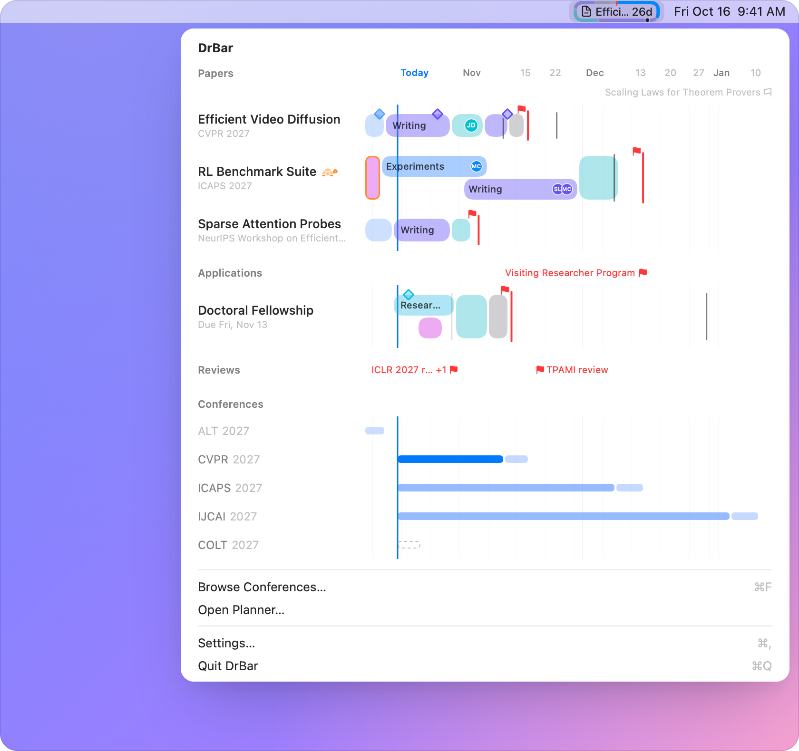
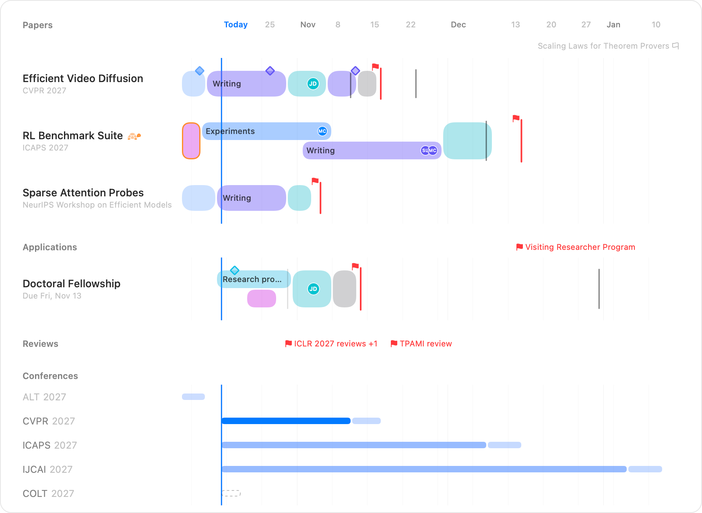
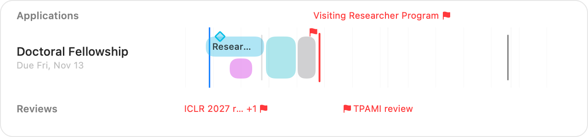
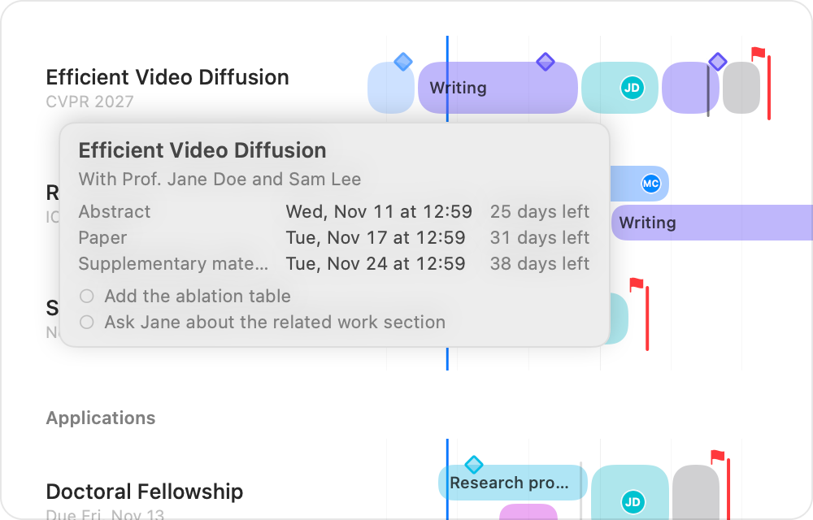
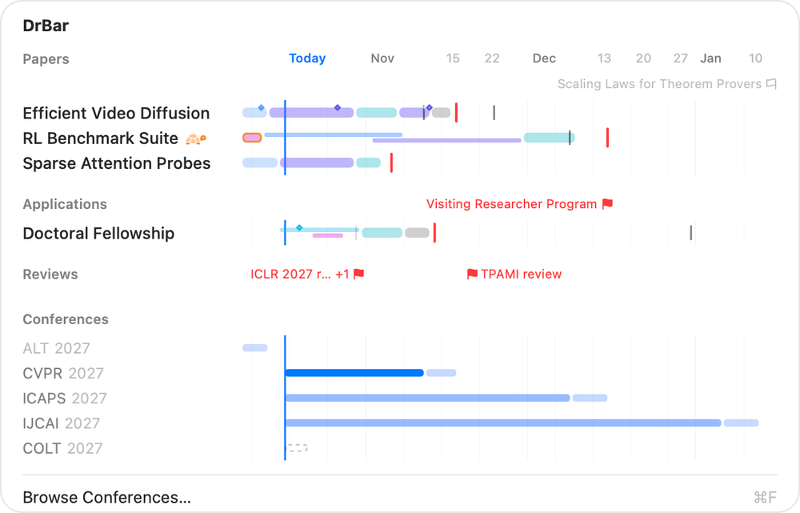
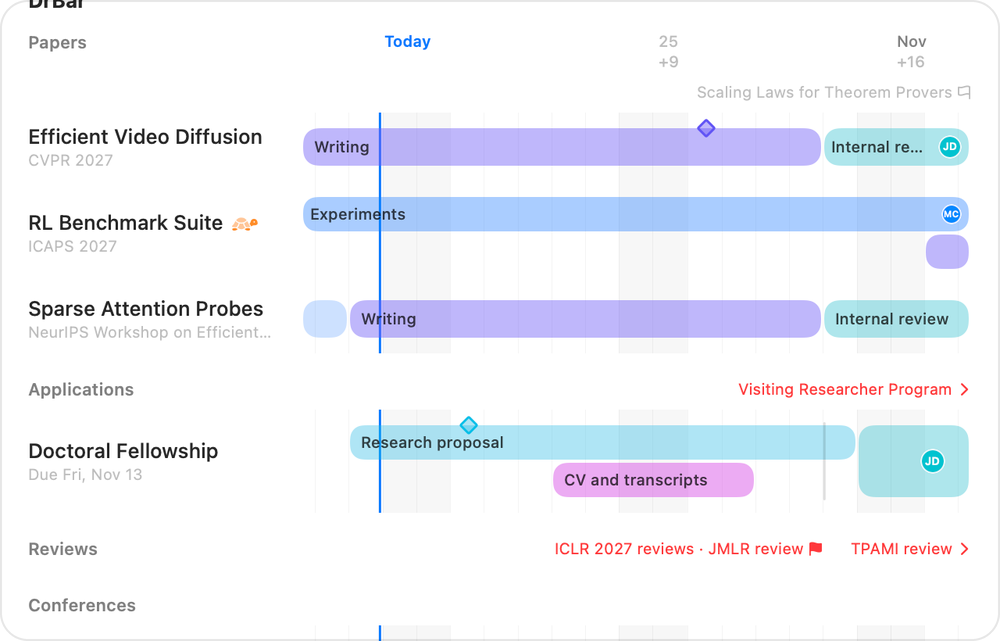
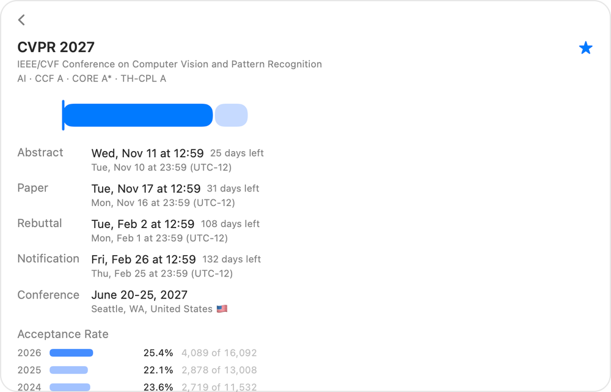

<p align="center">
  
</p>

<h1 align="center">DrBar</h1>

<h3 align="center">Every deadline. One timeline.<br>Right in your menu bar.</h3>

<p align="center">
  Conference deadlines from ccfddl and the plans of your papers, side by side as bars of time,
  so how long is left is simply how long the bar is.
</p>

<p align="center">
  <a href="https://github.com/zhiheng-yang/DrBar/releases"></a>
</p>

<p align="center">
  <a href="https://zhiheng-yang.github.io/DrBar/">Website</a> &nbsp;·&nbsp;
  <a href="docs/GUIDE.md">Guide</a> &nbsp;·&nbsp;
  <a href="README.zh-CN.md">中文</a>
</p>

<p align="center">
  <picture>
    <source media="(prefers-color-scheme: dark)" srcset="docs/images/framed/hero-dark.png">
    
  </picture>
</p>

<br>

<h3 align="center">Read it like a clock.</h3>

<p align="center">
  What is due next stands in a rounded frame whose outline keeps time. One round is the work's time,
  from its first day to the deadline at the top, and the colored stretch is what is left: orange
  within a week, red within three days. Pick a paper, and its plan goes round instead.
</p>

<p align="center">
  <picture>
    <source media="(prefers-color-scheme: dark)" srcset="docs/images/framed/menubar-states-dark.png">
    
  </picture>
</p>

<br>

<h3 align="center">Your whole term, on one axis.</h3>

<p align="center">
  Papers on top, then your own groups, then the conferences you follow. Pinch to zoom from a few days
  to two years: close in, every day has its column and weekends are shaded, so the days left can be
  counted on the bars.
</p>

<p align="center">
  <picture>
    <source media="(prefers-color-scheme: dark)" srcset="docs/images/framed/planner-dark.png">
    
  </picture>
</p>

<br>

<h3 align="center">A paper is a few stretches of time.</h3>

<p align="center">
  Experiments, writing, internal review, buffer: each kind of work has its row, in as many rounds as
  it takes. Plan backwards from the deadline in one click, then draw and drag blocks as in Calendar.
</p>

<p align="center">
  <picture>
    <source media="(prefers-color-scheme: dark)" srcset="docs/images/framed/paper-dark.png">
    
  </picture>
</p>

<p align="center">
  Add milestones, the people on each block, a to-do list and deadlines of your own. ⌘Z undoes, and
  whatever you delete waits 30 days in Recently Deleted.
</p>

<br>

<h3 align="center">Every conference, as ccfddl lists it.</h3>

<p align="center">
  No typing in dates. Search, filter by field and by CCF, CORE or TH-CPL rank, see recent acceptance
  rates and star the ones you submit to; next year's edition is followed by itself.
</p>

<p align="center">
  <picture>
    <source media="(prefers-color-scheme: dark)" srcset="docs/images/framed/conferences-dark.png">
    
  </picture>
</p>

<br>

<h3 align="center">And the rest of your work too.</h3>

<p align="center">
  Applications, reviews, teaching: make groups of your own and plan their items like papers. Work
  that is only a deadline takes no row at all, just a flag on its group's line.
</p>

<p align="center">
  <picture>
    <source media="(prefers-color-scheme: dark)" srcset="docs/images/framed/groups-dark.png">
    
  </picture>
</p>

<br>

<h3 align="center">Just ask.</h3>

<p align="center">
  Add work, move a block or hear what's next, by voice, in Spotlight or in the Shortcuts app, in
  English or Chinese.
</p>

<p align="center">
  “What’s next in DrBar?”<br>
  “Add to Reviews in DrBar”<br>
  “Postpone a block of Efficient Video Diffusion in DrBar”
</p>

<br>

<h3 align="center">Keep your supervisor in the loop.</h3>

<p align="center">
  <b>Send Progress</b> writes the paper's timeline into an email from your own Mail account, as a reply
  in the same thread, with what matters in the first line. Nobody needs to install anything.
</p>

<p align="center">
  
</p>

<br>

<h3 align="center">More, at a glance.</h3>

<table>
  <tr>
    <td width="50%">
      <picture>
        <source media="(prefers-color-scheme: dark)" srcset="docs/images/framed/gallery-hover-dark.png">
        
      </picture>
      <b>More where the bar can't say it.</b> Rest the pointer on a name for its deadlines, its people and what is left to do.
      <br><br>
      <picture>
        <source media="(prefers-color-scheme: dark)" srcset="docs/images/framed/gallery-compact-dark.png">
        
      </picture>
      <b>Three row sizes.</b> Down to a thin bar beside each name, so that everything fits.
    </td>
    <td width="50%">
      <picture>
        <source media="(prefers-color-scheme: dark)" srcset="docs/images/framed/gallery-labels-dark.png">
        
      </picture>
      <b>Dates, days from today, or both.</b> How far away something is reads at a glance.
      <br><br>
      <picture>
        <source media="(prefers-color-scheme: dark)" srcset="docs/images/framed/gallery-details-dark.png">
        
      </picture>
      <b>The whole cycle of a conference.</b> Every date of the round, in both time zones, and recent acceptance rates.
    </td>
  </tr>
</table>

<p align="center">
  Reminders 7, 3 and 1 days before a deadline and on a block's last day, once you turn them on ·
  an alert when ccfddl moves a date you follow · light, dark or as your Mac is set · English and
  Simplified Chinese
</p>

<br>

<h3 align="center">Your plans stay on your Mac.</h3>

<p align="center">
  Everything works offline, with no account, no analytics and no telemetry. The only download is
  ccfddl's conference data and acceptance rates, at most every 12 hours. Email goes out from your
  own Mail, only when you press Send, and DrBar never sees a password.
</p>

<br>

<h3 align="center">Free. Open source.<br>Made for PhD students.</h3>

<p align="center">
  <a href="https://github.com/zhiheng-yang/DrBar/releases"></a>
</p>

<p align="center">
  <sub>macOS 14 or later · English and Simplified Chinese · MIT License</sub>
</p>

<br>

## Get started

1. Download `DrBar-<version>.zip` from [Releases](https://github.com/zhiheng-yang/DrBar/releases),
   move DrBar to Applications and open it.
2. The first time, macOS can't verify DrBar and doesn't open it, as with any app not signed through
   Apple's paid developer program. Open **System Settings › Privacy & Security**, click **Open
   Anyway** next to the message about DrBar, and confirm; on macOS 14 you can also Control-click
   DrBar and choose **Open**. A graduation cap in a rounded frame appears in the menu bar.
3. Click it and choose **Browse Conferences…** (<kbd>⌘F</kbd>). Star the conferences you submit to.
4. **New Paper** (<kbd>⌘N</kbd>), type its title, then **Choose Conference…** under it. Every date of
   the round becomes one of its deadlines.
5. **Plan Backwards from Deadline**, then drag the blocks to fit your term.
6. Right-click the paper and **Show in Menu Bar** to watch its plan go round.

The [guide](docs/GUIDE.md) covers the rest, from reading the menu bar to asking Siri. To start DrBar
at login, turn on **Open at login** in Settings.

## Keyboard shortcuts

| Keys | Does |
| --- | --- |
| <kbd>⌘N</kbd> <kbd>⇧⌘N</kbd> | New paper, new group |
| <kbd>⌘F</kbd> | Browse conferences |
| <kbd>⌘←</kbd> <kbd>⌘→</kbd> <kbd>⌘T</kbd> | Earlier, later, back to today |
| <kbd>⌘+</kbd> <kbd>⌘−</kbd> <kbd>⌘0</kbd> | Zoom in, out, back to the chosen range |
| <kbd>Delete</kbd> <kbd>←</kbd> <kbd>→</kbd> <kbd>↩</kbd> | Delete, move or edit the selected block |
| <kbd>⌘D</kbd> <kbd>⌘Z</kbd> | Copy the selected block, undo |

## FAQ

<details>
<summary><b>Where do the dates come from, and are they right?</b></summary>

From [ccfddl](https://github.com/ccfddl/ccf-deadlines), the community-maintained list of CCF
conferences, exactly as it lists them; DrBar never guesses a date from last year. When a call for
papers gives no time, ccfddl uses 23:59, and when it gives no time zone, AoE (anywhere on Earth).
Always check the conference's website before you submit. If a date is wrong,
[report it to ccfddl](https://github.com/ccfddl/ccf-deadlines/issues); until it is fixed, give the
paper a deadline of its own.
</details>

<details>
<summary><b>Does it work offline?</b></summary>

Yes. The first launch uses the ccfddl data that comes with the app, and everything else is on your
Mac. Online, DrBar looks for new data at most every 12 hours.
</details>

<details>
<summary><b>How do I move my data to another Mac?</b></summary>

In Settings › Data, choose **Export…**, then **Import…** the file on the other Mac. Everything is in
that one file: papers, groups, plans, deadlines, stars and settings.
</details>

<details>
<summary><b>Siri doesn't know DrBar.</b></summary>

Open DrBar once from Applications. Siri listens in the language it is set to, so say "What's next in
DrBar?" in English or "DrBar里接下来是什么" in Chinese. The Shortcuts app lists DrBar's actions too.
</details>

<details>
<summary><b>Which mail apps can send progress?</b></summary>

With Mail, each update is a reply in the paper's own thread. With another mail app, DrBar opens the
email there with the text filled in and copies the image for you to paste (<kbd>⌘V</kbd>) before you
press Send.
</details>

<details>
<summary><b>Why does macOS stop DrBar the first time?</b></summary>

DrBar is free and open source, and its releases are not signed through Apple's paid developer
program, so macOS can't check them as it checks apps from the App Store. Each new version is allowed
once the same way (see Get started). You can also read the code and build DrBar yourself.
</details>

<details>
<summary><b>How do I update or uninstall it?</b></summary>

To update, replace DrBar in Applications with the new version; your data stays. To uninstall,
choose **Remove All Data…** in Settings › Data, then move DrBar to the Trash. DrBar is one app, with
no installer and no helper; macOS keeps only the empty folder it makes for every sandboxed app, in
`~/Library/Containers`, which you can delete too.
</details>

## Build from source

[](https://github.com/zhiheng-yang/DrBar/actions/workflows/ci.yml)

You need Xcode 26 and [XcodeGen](https://github.com/yonaskolb/XcodeGen).

```sh
git clone https://github.com/zhiheng-yang/DrBar.git
cd DrBar
scripts/bootstrap.sh   # installs XcodeGen if needed, creates Config/Local.xcconfig, generates the project
scripts/run.sh --demo  # builds and runs it on sample data; or open DrBar.xcodeproj and press ⌘R
```

[CONTRIBUTING.md](CONTRIBUTING.md) has the layout, the checks and how translations work.

## Feedback

DrBar is a preview: it is still taking shape, and some things may change from one version to the
next. Ideas, problems and wishes are all welcome; [open an issue](https://github.com/zhiheng-yang/DrBar/issues/new/choose).

## Acknowledgements

Conference data and acceptance rates by the [ccfddl](https://github.com/ccfddl/ccf-deadlines)
contributors (MIT). YAML parsing by [Yams](https://github.com/jpsim/Yams) (MIT). See
[THIRD_PARTY_NOTICES.md](THIRD_PARTY_NOTICES.md).

## License

[MIT](LICENSE)
