<p align="center">
  
</p>

<h1 align="center">DrBar</h1>

<h3 align="center">每个 DDL，一条时间轴，<br>就在菜单栏里。</h3>

<p align="center">
  ccfddl 的会议 DDL 和你每篇论文的计划，并排画成一条条时间，离 DDL 还有多久，就是横条有多长。
</p>

<p align="center">
  <a href="https://github.com/zhiheng-yang/DrBar/releases"></a>
</p>

<p align="center">
  <a href="https://zhiheng-yang.github.io/DrBar/">网站</a> &nbsp;·&nbsp;
  <a href="docs/GUIDE.zh-CN.md">使用指南</a> &nbsp;·&nbsp;
  <a href="README.md">English</a>
</p>

<p align="center">
  <picture>
    <source media="(prefers-color-scheme: dark)" srcset="docs/images/framed/hero-dark-zh.png">
    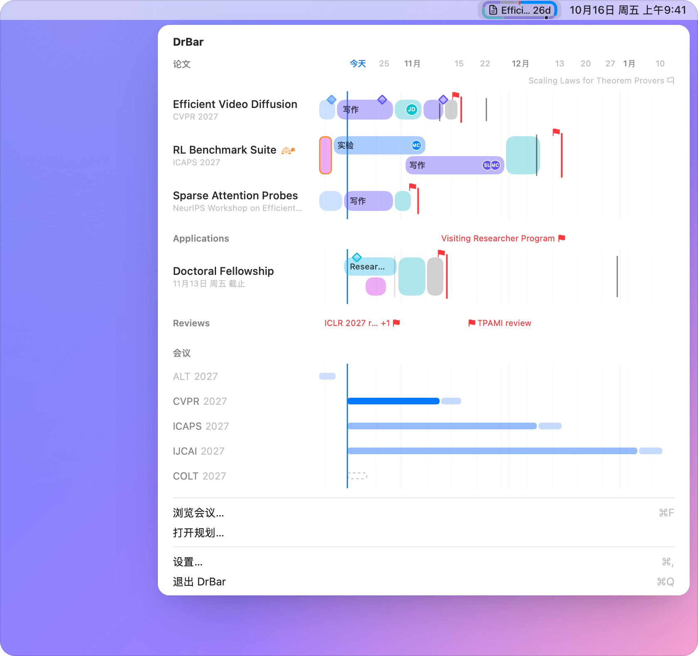
  </picture>
</p>

<br>

<h3 align="center">像看钟一样看它。</h3>

<p align="center">
  最近要交的东西放在一个圆角边框里，边框就是一块表。一圈是这项工作从第一天到顶上 DDL 的时间，有颜色的那一段就是还剩下的：一周之内变橙，三天之内变红。指定一篇论文，绕着走的就换成它的计划。
</p>

<p align="center">
  <picture>
    <source media="(prefers-color-scheme: dark)" srcset="docs/images/framed/menubar-states-dark.png">
    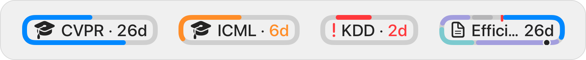
  </picture>
</p>

<br>

<h3 align="center">整个学期，一条时间轴。</h3>

<p align="center">
  上面是论文，然后是你自己建的分组，最后是你关注的会议。双指捏合，在几天到两年之间缩放：放大后每天各占一格、周末有底色，还剩几天在横条上就能数出来。
</p>

<p align="center">
  <picture>
    <source media="(prefers-color-scheme: dark)" srcset="docs/images/framed/planner-dark-zh.png">
    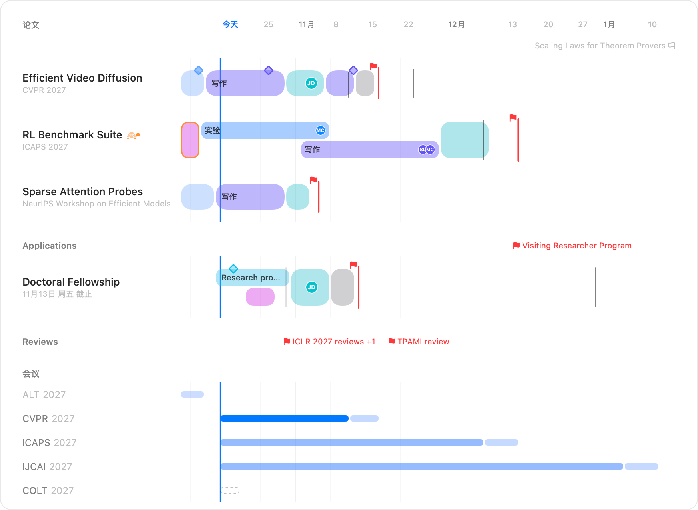
  </picture>
</p>

<br>

<h3 align="center">一篇论文，就是几段时间。</h3>

<p align="center">
  实验、写作、内审修改、缓冲，每类工作一行，可以分好几轮。一键从 DDL 倒推出计划，再像"日历"一样画出、拖动时间块。
</p>

<p align="center">
  <picture>
    <source media="(prefers-color-scheme: dark)" srcset="docs/images/framed/paper-dark-zh.png">
    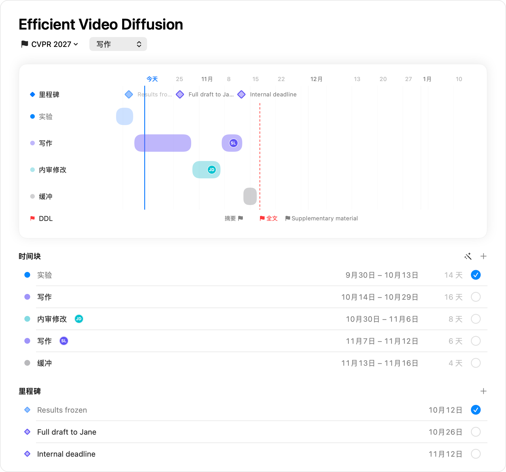
  </picture>
</p>

<p align="center">
  还能加里程碑、标出谁在做哪一段、列个待办，再加上自己的 DDL。<br>
  ⌘Z 可以撤销，删掉的东西在"最近删除"里保留 30 天。
</p>

<br>

<h3 align="center">所有会议，和 ccfddl 一样全。</h3>

<p align="center">
  不用手动录入日期。搜索、按领域和 CCF、CORE、TH-CPL 等级筛选，看近几年的录用率，给要投的会议标星；明年的新一届会自动关注。
</p>

<p align="center">
  <picture>
    <source media="(prefers-color-scheme: dark)" srcset="docs/images/framed/conferences-dark-zh.png">
    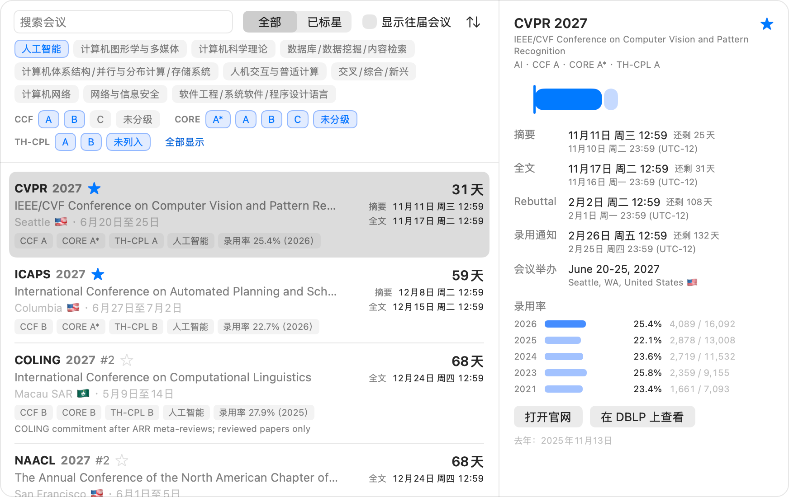
  </picture>
</p>

<br>

<h3 align="center">其他工作，也放得下。</h3>

<p align="center">
  申请、审稿、助教：自己建分组，里面的事项像论文一样排计划。只有一个 DDL 的工作不占一行，只是分组那一行上的一面小旗。
</p>

<p align="center">
  <picture>
    <source media="(prefers-color-scheme: dark)" srcset="docs/images/framed/groups-dark-zh.png">
    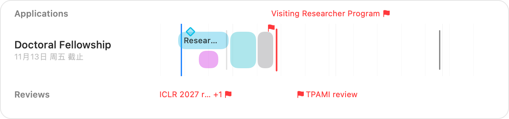
  </picture>
</p>

<br>

<h3 align="center">问一句就行。</h3>

<p align="center">
  添加工作、挪动时间块、问问接下来要交什么，用语音、聚焦搜索或"快捷指令"都行，中英文都可以。
</p>

<p align="center">
  “DrBar里接下来是什么”<br>
  “在DrBar里添加到审稿”<br>
  “在DrBar里推迟Efficient Video Diffusion的时间块”
</p>

<br>

<h3 align="center">让导师随时知道进展。</h3>

<p align="center">
  <b>发送进展</b> 会用你自己的"邮件"账户，把论文的时间轴写进一封邮件，作为同一个对话里的回复，第一行就写明最要紧的事。对方什么都不用装。
</p>

<p align="center">
  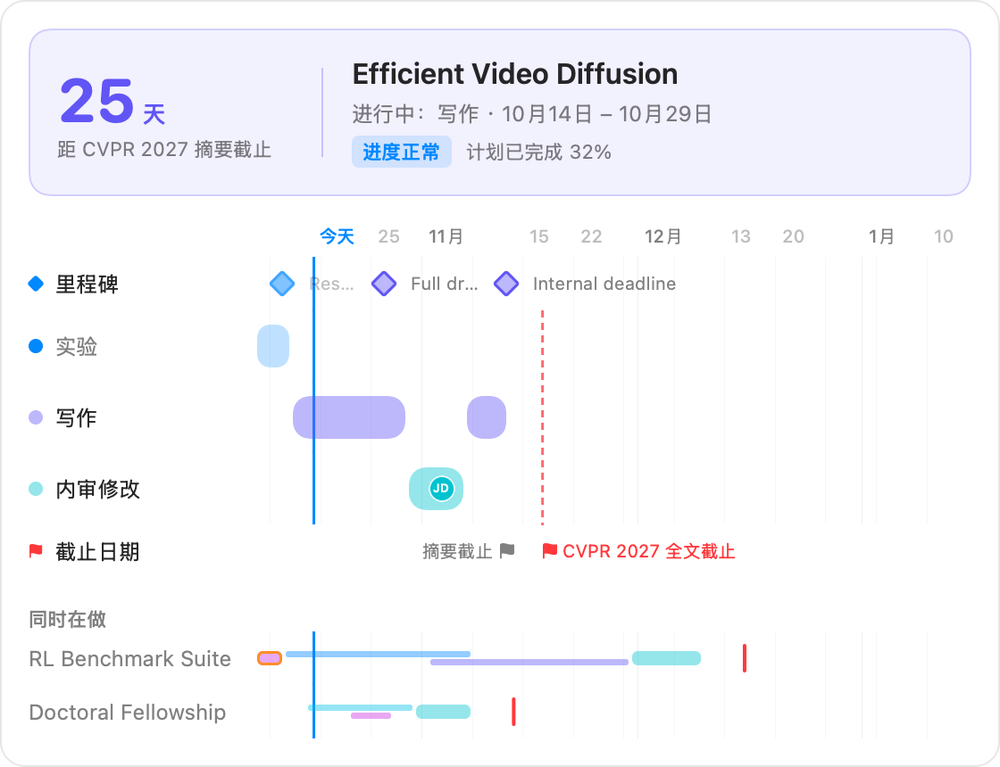
</p>

<br>

<h3 align="center">一眼看到更多。</h3>

<table>
  <tr>
    <td width="50%">
      <picture>
        <source media="(prefers-color-scheme: dark)" srcset="docs/images/framed/gallery-hover-dark-zh.png">
        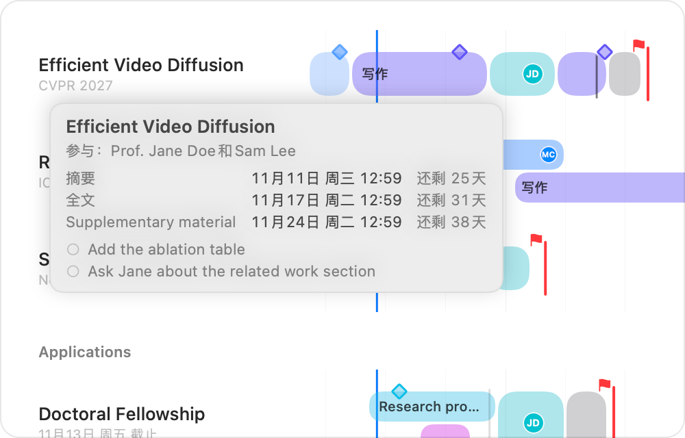
      </picture>
      <b>横条说不清的，停一下就知道。</b> 把指针停在名字上，就能看到 DDL、参与的人和还剩的待办。
      <br><br>
      <picture>
        <source media="(prefers-color-scheme: dark)" srcset="docs/images/framed/gallery-compact-dark-zh.png">
        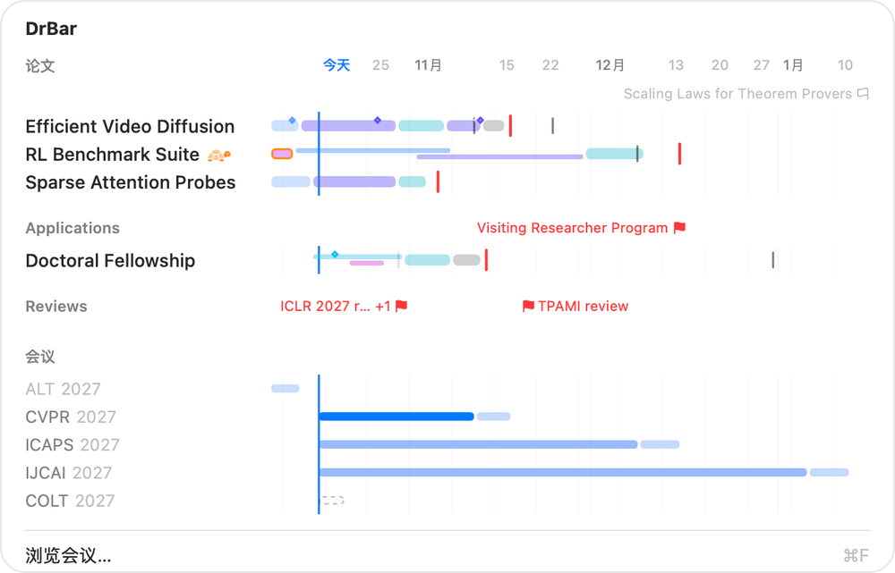
      </picture>
      <b>三档行高。</b> 最小时每个名字旁只剩一条细横条，东西再多也能一屏看完。
    </td>
    <td width="50%">
      <picture>
        <source media="(prefers-color-scheme: dark)" srcset="docs/images/framed/gallery-labels-dark-zh.png">
        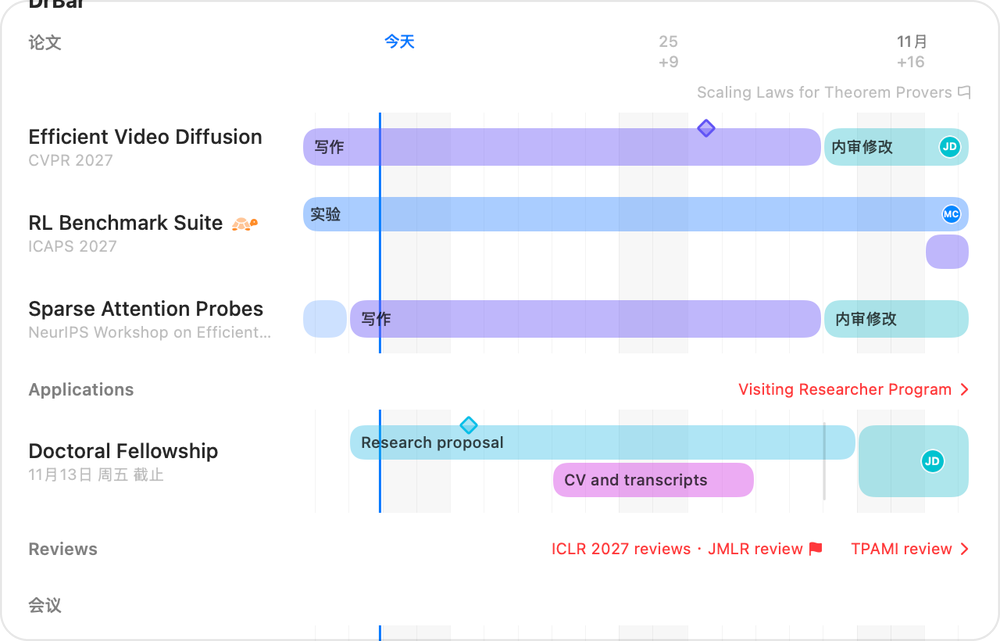
      </picture>
      <b>日期、距今天数，或者两个都标。</b> 离 DDL 还有多远，一眼就能读出来。
      <br><br>
      <picture>
        <source media="(prefers-color-scheme: dark)" srcset="docs/images/framed/gallery-details-dark-zh.png">
        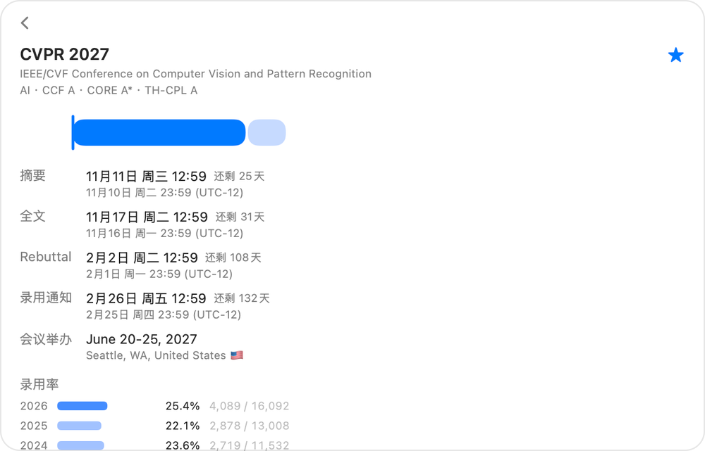
      </picture>
      <b>一个会议的完整周期。</b> 这一轮的每个日期都有你的时间和会议的时间，还有近几年的录用率。
    </td>
  </tr>
</table>

<p align="center">
  提醒（在设置里打开后）：DDL 前 7、3、1 天，以及时间块的最后一天 · ccfddl 改动了你关注的日期时会通知 · 浅色、深色或跟随系统 · 简体中文和英文
</p>

<br>

<h3 align="center">你的计划，只留在你的 Mac 上。</h3>

<p align="center">
  没有网络也一切照常，不用登录，没有统计和遥测。唯一的下载是 ccfddl 的会议数据和录用率，最多每 12 小时一次。邮件从你自己的"邮件"发出，只在你点发送时，DrBar 也不会接触任何密码。
</p>

<br>

<h3 align="center">免费，开源，<br>为博士生而做。</h3>

<p align="center">
  <a href="https://github.com/zhiheng-yang/DrBar/releases"></a>
</p>

<p align="center">
  <sub>macOS 14 或更高版本 · 简体中文和英文 · MIT 许可证</sub>
</p>

<br>

## 开始使用

1. 在 [Releases](https://github.com/zhiheng-yang/DrBar/releases) 下载 `DrBar-<版本号>.zip`，把 DrBar 拖进"应用程序"并打开。
2. 第一次打开时，macOS 无法验证 DrBar，不会打开它；凡是没有通过苹果付费开发者计划签名的 App 都会这样。打开 **系统设置 › 隐私与安全性**，在关于 DrBar 的提示旁点 **仍要打开** 并确认；在 macOS 14 上，也可以按住 Control 点 DrBar，选 **打开**。之后菜单栏里会出现一个圆角边框，里面是学位帽。
3. 点一下边框，选 **浏览会议…**（<kbd>⌘F</kbd>），给要投的会议标星。
4. **新建论文**（<kbd>⌘N</kbd>），输入标题，在下面点 **选择会议…**。这一轮的每个日期都成了它的 DDL。
5. 点 **从 DDL 倒推生成**，再拖动时间块排进你的日程。
6. 右键这篇论文，选 **在菜单栏显示**，就能看它的计划绕着边框走。

其余的都在 [使用指南](docs/GUIDE.zh-CN.md) 里，从看懂菜单栏讲到怎么问 Siri。想开机自动启动，在设置里打开 **开机启动**。

## 快捷键

| 按键 | 作用 |
| --- | --- |
| <kbd>⌘N</kbd> <kbd>⇧⌘N</kbd> | 新建论文、新建分组 |
| <kbd>⌘F</kbd> | 浏览会议 |
| <kbd>⌘←</kbd> <kbd>⌘→</kbd> <kbd>⌘T</kbd> | 往前、往后、回到今天 |
| <kbd>⌘+</kbd> <kbd>⌘−</kbd> <kbd>⌘0</kbd> | 放大、缩小、回到选定范围 |
| <kbd>Delete</kbd> <kbd>←</kbd> <kbd>→</kbd> <kbd>↩</kbd> | 删除、挪动或编辑选中的时间块 |
| <kbd>⌘D</kbd> <kbd>⌘Z</kbd> | 复制选中的时间块、撤销 |

## 常见问题

<details>
<summary><b>日期从哪来，准不准？</b></summary>

来自社区维护的 CCF 会议列表 [ccfddl](https://github.com/ccfddl/ccf-deadlines)，原样显示，DrBar 不会用往年的日期去猜。官网只给日期不给时间时，ccfddl 填 23:59；不给时区时填 AoE（地球上任何地方）。投稿前请务必以会议官网为准。发现日期有误，请 [反馈给 ccfddl](https://github.com/ccfddl/ccf-deadlines/issues)；修正之前，可以先给论文加一个自己的 DDL。
</details>

<details>
<summary><b>没有网络能用吗？</b></summary>

能。第一次打开时用的是 App 自带的 ccfddl 数据，其他一切都在你的 Mac 上。联网时，DrBar 最多每 12 小时看一次有没有新数据。
</details>

<details>
<summary><b>怎么把数据搬到另一台 Mac？</b></summary>

在 设置 › 数据 里点 **导出…**，再到另一台 Mac 上 **导入…** 这个文件。论文、分组、计划、DDL、标星和设置都在这一个文件里。
</details>

<details>
<summary><b>Siri 不认识 DrBar？</b></summary>

先从"应用程序"里打开一次 DrBar。Siri 用它设置的语言来听：中文说"DrBar里接下来是什么"，英文说"What's next in DrBar?"。"快捷指令"App 里也列着 DrBar 的所有操作。
</details>

<details>
<summary><b>哪些邮件 App 能发进展？</b></summary>

用"邮件"时，每次更新都是这篇论文那个对话里的一封回复。用其他邮件 App 时，DrBar 会在那里新建一封填好内容的邮件，并把图片复制到剪贴板，粘贴（<kbd>⌘V</kbd>）后由你自己点发送。
</details>

<details>
<summary><b>为什么第一次打开时 macOS 会拦下 DrBar？</b></summary>

DrBar 免费开源，发布的版本没有通过苹果付费开发者计划签名，所以 macOS 没法像检查 App Store 里的 App 那样检查它。每个新版本第一次打开时都要这样允许一次（见"开始使用"）。你也可以读源码，自己构建 DrBar。
</details>

<details>
<summary><b>怎么更新、怎么卸载？</b></summary>

更新时，用新版本替换"应用程序"里的 DrBar 即可，数据会保留。卸载时，先在 设置 › 数据 里点 **移除所有数据…**，再把 DrBar 拖到废纸篓。DrBar 只是一个 App，没有安装器，也没有附带程序；macOS 只会保留它为每个沙盒 App 建的空文件夹（在 `~/Library/Containers` 里），也可以一并删掉。
</details>

## 从源码构建

[](https://github.com/zhiheng-yang/DrBar/actions/workflows/ci.yml)

需要 Xcode 26 和 [XcodeGen](https://github.com/yonaskolb/XcodeGen)。

```sh
git clone https://github.com/zhiheng-yang/DrBar.git
cd DrBar
scripts/bootstrap.sh   # 按需安装 XcodeGen、创建 Config/Local.xcconfig、生成工程
scripts/run.sh --demo  # 编译并用示例数据运行；也可以打开 DrBar.xcodeproj 按 ⌘R
```

目录结构、检查项和翻译方法见 [CONTRIBUTING.md](CONTRIBUTING.md)。

## 反馈

DrBar 目前是测试版本，还在打磨中，不同版本之间可能会有变化。欢迎提意见、报告问题，或者说说你想要的功能：[提一个 issue](https://github.com/zhiheng-yang/DrBar/issues/new/choose)。

## 致谢

会议数据和录用率来自 [ccfddl](https://github.com/ccfddl/ccf-deadlines) 的贡献者（MIT 许可证）。YAML 解析使用 [Yams](https://github.com/jpsim/Yams)（MIT 许可证）。详见 [THIRD_PARTY_NOTICES.md](THIRD_PARTY_NOTICES.md)。

## 许可证

[MIT](LICENSE)
