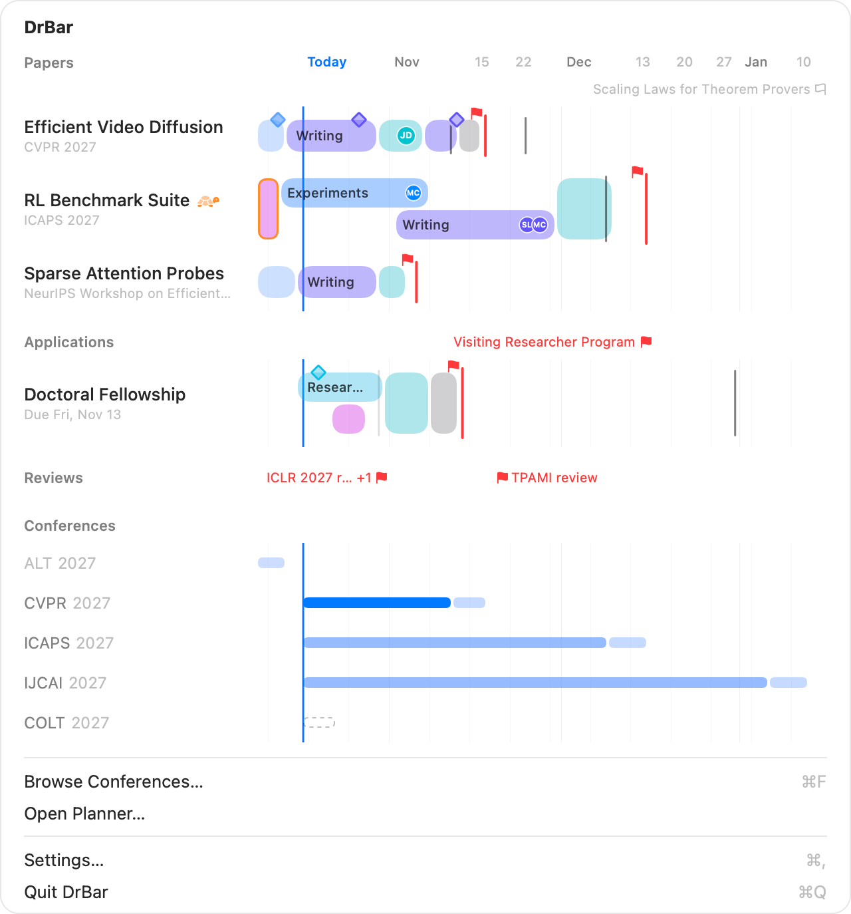
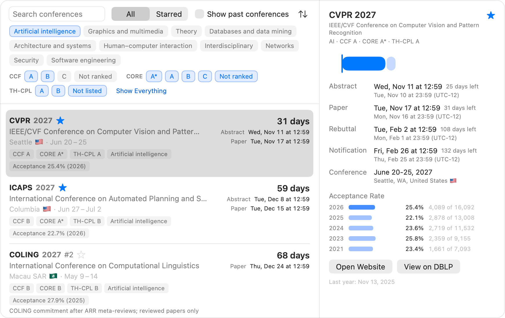
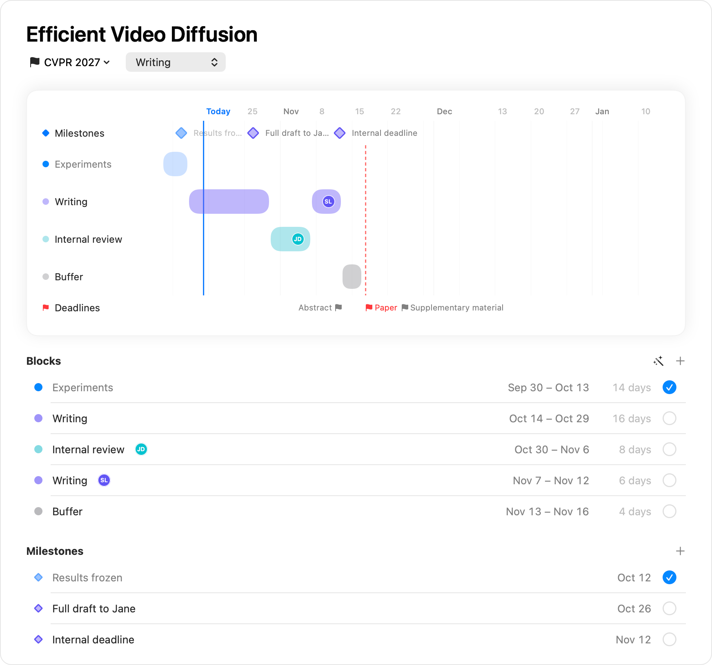
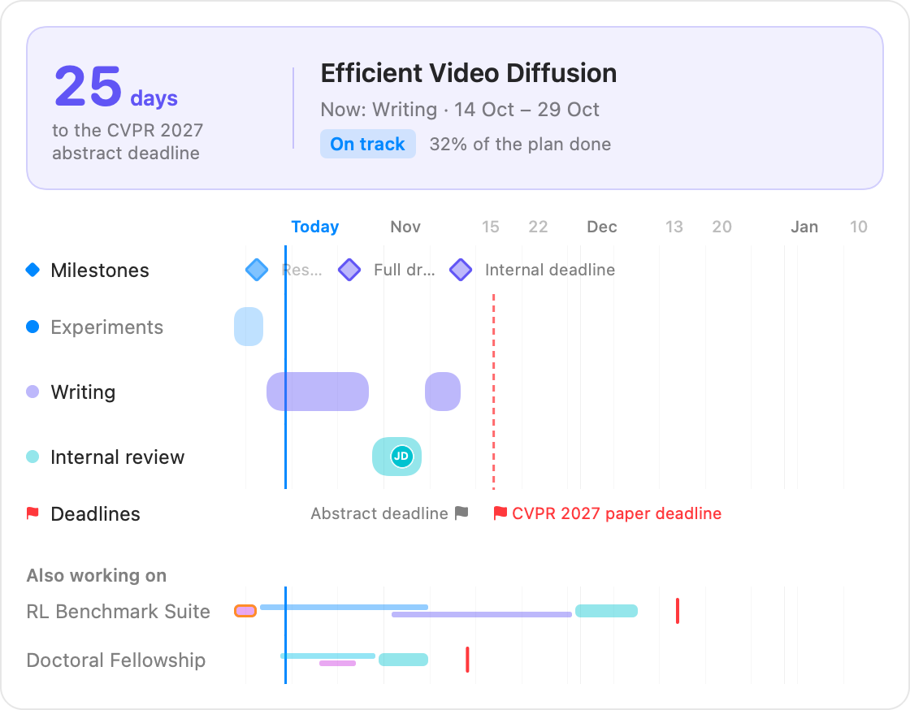

# Using DrBar

From the first launch to a plan that keeps itself in view: what DrBar shows, how to read it, and
how to change it. [中文版](GUIDE.zh-CN.md)

1. [Install and open it](#1-install-and-open-it)
2. [Read the menu bar](#2-read-the-menu-bar)
3. [The window under the menu bar](#3-the-window-under-the-menu-bar)
4. [Follow your conferences](#4-follow-your-conferences)
5. [Add a paper and plan it](#5-add-a-paper-and-plan-it)
6. [Edit on the timeline](#6-edit-on-the-timeline)
7. [Milestones, deadlines and to-dos](#7-milestones-deadlines-and-to-dos)
8. [Groups for the rest of your work](#8-groups-for-the-rest-of-your-work)
9. [Look back, look ahead](#9-look-back-look-ahead)
10. [Reminders](#10-reminders)
11. [Send progress to your supervisor](#11-send-progress-to-your-supervisor)
12. [Siri, Spotlight and Shortcuts](#12-siri-spotlight-and-shortcuts)
13. [Settings](#13-settings)
14. [Keyboard shortcuts](#14-keyboard-shortcuts)
15. [Your data](#15-your-data)
16. [When something is off](#16-when-something-is-off)

## 1. Install and open it

1. Download `DrBar-<version>.zip` from
   [Releases](https://github.com/zhiheng-yang/DrBar/releases) and unzip it.
2. Move **DrBar** to **Applications** and open it. The first time, macOS can't verify DrBar and
   doesn't open it, as with any app not signed through Apple's paid developer program: open
   **System Settings › Privacy & Security**, click **Open Anyway** next to the message about DrBar,
   and confirm. On macOS 14 you can also Control-click DrBar and choose **Open**. Each new version
   is allowed once the same way.
3. DrBar lives in the menu bar: a graduation cap in a rounded frame appears there, and there is no
   Dock icon until you open the planner.
4. Click the frame. With nothing followed yet, the window asks you to star the conferences you
   submit to; **Browse Conferences…** (⌘F) takes you there.

DrBar needs macOS 14 or later. To start it at login, turn on **Open at login** in Settings.

## 2. Read the menu bar

<picture>
  <source srcset="images/framed/menubar-dark.png" media="(prefers-color-scheme: dark)">
  
</picture>

The item is a rounded frame, and its thick outline is a clock. Time goes round it clockwise to the
deadline, which sits in the middle of the top edge.

- **The colored stretch is the time left.** It runs from now up to the top, and one round is the
  time from when the work started, the first day of its plan or else the day you added it, to the
  deadline: the whole outline when it starts, half of it halfway there. It shrinks toward the top
  as the deadline comes, as a timer does. A conference you only follow goes round in 30 days.
- **Its color says how close:** your accent color while there is time (blue if the accent is red
  or orange), orange within a week, red within three days, when a red **!** also takes the place of
  the graduation cap.
- **The name** is the conference or the work that is due next; the days left can stand beside it.

Pick a paper or an item for the menu bar, and its plan goes round the outline instead, from its
first day to its deadline at the top:

- each block is a stretch in the block's color, **solid when done**, faint while still to do;
- a **dot** marks today: plain while the plan keeps up, **orange** when work is overdue, **red**
  when work runs past the deadline;
- a **red mark** across the outline is the deadline. Blocks that run past it go past the mark.
- where blocks **overlap**, the outline shows one at a time: the block that starts later, from its
  first day; the earlier one shows again where it lasts longer. The window shows both, one above
  the other.

So what is done (solid, behind the dot), where you are (the dot) and what is left (faint, ahead
of it) show at a glance, and so does which kind of work is behind.

To choose what it shows, use **Show in Menu Bar** in the menu of any paper, item or conference, or
**Menu bar shows** in Settings. The style is in Settings too:

| Style | Shows |
|---|---|
| Symbol and name | the next deadline's name; for picked work, also its days |
| Symbol, name and days | the name and the days left, `12d`, or `5h12m` under a day |
| Two deadlines | the next two deadlines, each in a frame of its own with its days |
| Symbol only | the frame around the symbol alone, for a crowded menu bar |

## 3. The window under the menu bar

<picture>
  <source srcset="images/framed/popover-dark.png" media="(prefers-color-scheme: dark)">
  
</picture>

Click the menu bar item to open a small Gantt chart. Every bar shares one time axis, so how far
away something is, is how long its bar is.

- **Papers** come first, then each of your groups, then **Conferences** you follow.
- A paper's row is its plan: a segment per block, solid when done, faint when not. Diamonds on the
  bar's top edge are milestones. A **red line** through the bar is the deadline the plan aims at,
  with a small red flag beside it; gray ticks are its other deadlines.
- Work that is only a deadline, such as a review due on a day, has no row: its **flags** stand on
  the line of its group's name, named for it.
- Followed conferences under the work are thin, quiet bars from today to their deadlines, the
  abstract and then the paper deadline in a lighter part.
- **Rest the pointer** on a block, a name or a conference for what the bar can't say: who works on
  it, the exact times, the time left, the next to-dos. **Click a conference** for its details.
- **Click a block** to select it: Delete or Backspace removes it (it waits in Recently Deleted,
  and ⌘Z brings it back), ← and → move it a day (⇧ for a week), Return opens it in the planner.

## 4. Follow your conferences

Open the planner (**Open Planner…** in the window, or ⌘F for **Conferences**).

<picture>
  <source srcset="images/framed/conferences-dark.png" media="(prefers-color-scheme: dark)">
  
</picture>

- Every conference to come is listed as [ccfddl](https://github.com/ccfddl/ccf-deadlines) lists it:
  full name, where and when it meets, CCF, CORE and TH-CPL ranks, field, acceptance rate, and the
  abstract and paper deadlines with the time left.
- **Search**, keep to the fields and ranks you pick with the buttons above the list, sort by
  deadline, name, rank or acceptance rate, or show past conferences.
- **Star** the ones you submit to. A star follows the series, so next year's edition is followed by
  itself. Starred conferences appear in the menu bar window and count down in the menu bar.

The data updates by itself at most every 12 hours; everything works offline.

## 5. Add a paper and plan it

1. **New Paper** (⌘N) in the planner, or the **+** beside Papers in the sidebar. Type its title.
2. Under the title, click the target menu and **Choose Conference…**. Pick the edition, and the
   round if it has several. The paper now has every date of that round as its deadlines: abstract
   registration, paper submission, rebuttal and notification.
3. Click **Plan Backwards from Deadline**. DrBar counts back from the paper deadline: buffer 2
   days, internal review 7 days, writing 14 days, experiments from today until writing starts.
   Adjust it by hand afterwards; nothing moves by itself again.
4. Set the **stage** (Idea, Experiments, Writing, Submitted, Decided) in the menu beside the target.
   Marking it Submitted ticks off the paper deadline and what came before it.

<picture>
  <source srcset="images/framed/paper-dark.png" media="(prefers-color-scheme: dark)">
  
</picture>

A paper whose work runs late shows **behind**; work that runs past the deadline it leads up to
shows a **conflict**.

## 6. Edit on the timeline

On a paper's page the plan has a row for each kind of work, and editing works as in Calendar:

| To | Do this |
|---|---|
| Draw a block | Drag across empty days in a row; a double click draws a week |
| Add another round | Hover the row's name and click **+** |
| Make it longer or shorter | Drag either end |
| Move it | Drag its middle, a day at a time; the trackpad taps at today, a deadline or another block |
| Copy it | Drag with ⌥ held, or ⌘D with it selected |
| Select it | Click; the ring is blue while the keys act on it |
| Delete it | Delete or Backspace with it selected, or its menu |
| Nudge it | ← and →, a day; with ⇧, a week |
| Edit its name, dates or people | Double click, or Return |
| Tick it off | Its circle in the Blocks list, or **Mark as Done** in its menu |
| Undo | ⌘Z, one step at a time |

Dragging also works in the overview and in the window under the menu bar. A drag held near either
end of the bars scrolls the axis along. Esc during a drag puts the block back.

Put people on a block (your supervisor on the internal review, a co-author on experiments) from
its editor or its menu; they show as small monograms on the block.

## 7. Milestones, deadlines and to-dos

- **Milestones** are days something is due by, such as an internal deadline or a draft for your
  supervisor: double click an empty day in the Milestones row, or use **+**. They are diamonds,
  filled once done and edged in orange when their day passed without them.
- **Deadlines of your own** (a supplementary, a camera-ready, a workshop, an application's letters)
  go in the Deadlines row: double click a day, or **Add Deadline…** in the target menu. Each has a
  name, a time zone (local, AoE, UTC, UTC±N or PT), a link and a note.
- The **red flag** marks the deadline the plan aims at, then the next one once it is done. Tick
  deadlines off in the Deadlines list as they pass.
- **To-dos** are a short checklist per paper: type into the last line to add one, tick it when done,
  and **Clear Done** removes the finished ones.

## 8. Groups for the rest of your work

Besides Papers, make groups for other work with deadlines: Applications, Reviews, Teaching.

- **New Group** (⇧⌘N) at the foot of the sidebar; type its name, and pick a symbol from its menu.
- **+** beside a group adds an item. Items are planned like papers, with blocks, milestones,
  deadlines and reminders, without stages or emails.
- An item without blocks is just its deadlines: flags on its group's line in the menu bar window
  and the overview. Two due on the same day share one flag. It gets a row of its own with its first
  block.
- Drag a group's heading to reorder the groups, and an item into another group to move it there.

## 9. Look back, look ahead

- **Swipe** sideways on the trackpad, scroll sideways, or drag across empty space to move the axis,
  up to a year either way. ⌘← and ⌘→ step; ⌘T comes back to today, as does **‹ Today** or a double
  click on the dates.
- **Pinch**, or scroll with ⌘ held, to zoom from three days to two years. ⌘+ and ⌘− zoom around
  today, and ⌘0 goes back to the chosen range: a week, a month, three or six months.
- Close in, every day has a column and the weekends are shaded, so days can be counted on the
  bars. Right-click the dates above any timeline to label it with **Dates**, **Days from Today**, or
  both.
- **View › Row Size** makes every row large, medium or small, down to a thin bar beside each name.

## 10. Reminders

Turn reminders on in **Settings › Reminders**; macOS asks for permission then, never before.

- 7, 3 and 1 day before each deadline (14 and 30 can be added), once however many papers share it;
- at 9:00 on the last day of a block that is not done, and on a milestone's day, with **Mark as
  Done** right in the notification;
- when ccfddl moves a date you follow.

## 11. Send progress to your supervisor

1. In **Settings › Email**, give your name and the address you send from, and put people in the
   groups: Supervisors, Collaborators, or groups of your own, each with its language.
2. On a paper's page, click **Send Progress**. The sheet shows the image that will go, the subject
   and the first line; add a message if you like, and press **Send** (⌘↩).

Mail sends it from your own account, as a reply in the same thread as the last update, so each
group sees one conversation. The first line tells the news before the email is opened. **Include
other work** adds what else you are doing, only the work you made **Visible To** everyone it goes
to.

## 12. Siri, Spotlight and Shortcuts

Say or type to Siri, in English or Chinese, as Siri is set:

| Ask | It does |
|---|---|
| "What's next in DrBar?" | Says the next deadline, when it is and how long is left |
| "Add a new item in DrBar" | Asks for the title, the day it is due and the group, then adds it |
| "Add to Reviews in DrBar" | The same, into Reviews |
| "Add a deadline to JCC in DrBar" | Adds a deadline of its own on a day |
| "Add a block to Video Diffusion in DrBar" | Asks the kind of work, the start and how many days |
| "Postpone a block of Video Diffusion in DrBar" | Asks which block and the new start |
| "Extend a block of Video Diffusion in DrBar" | Asks which block and the new end |
| "Mark a block of Video Diffusion as done in DrBar" | Ticks it off |
| "Open JCC in DrBar" | Opens it in the planner |

In Chinese: "DrBar里接下来是什么", "在DrBar里新建事项", "在DrBar里推迟Video Diffusion的时间块".

The same actions are in **Spotlight** (⌘Space, then type "Next Deadline") and in the **Shortcuts**
app, under DrBar, where they can be part of your own shortcuts. Siri hears new titles after they
are saved. Nothing can be deleted this way.

## 13. Settings

- **General:** appearance, the default range, what the axis is labelled with, row size, the menu bar
  style and what it shows, open at login.
- **Reminders:** on or off, how long before, block reminders, alerts when a date changes.
- **Email:** your name and address, groups of recipients and their people.
- **Data:** sync status and Sync Now, the data folder, export and import, **Remove All Data…**.

## 14. Keyboard shortcuts

| Keys | Does |
|---|---|
| ⌘N, ⇧⌘N | New paper, new group |
| ⌘F | Browse conferences |
| ⌘← ⌘→, ⌘T | Earlier, later, back to today |
| ⌘+ ⌘−, ⌘0 | Zoom in, out, back to the chosen range |
| ⌘[ ⌘] | Back, forward between pages |
| Delete, Backspace | Delete the selected block, milestone or deadline |
| ← →, ⇧← ⇧→ | Move the selection a day, a week |
| Return, Esc | Edit the selection, let it go |
| ⌘D | Copy the selected block right after it |
| ⌘Z, ⇧⌘Z | Undo, redo |
| ⌘, | Settings |

## 15. Your data

Everything stays on your Mac, in DrBar's own sandbox folder: no account, no analytics. The only
downloads are the ccfddl conference data. Whatever you delete, a whole paper or a single block,
waits thirty days in **Recently Deleted**. **Archive** puts finished work away with all it has.

To uninstall, click **Remove All Data…** in Settings › Data, then move DrBar to the Trash.

## 16. When something is off

- **A date looks wrong:** DrBar shows dates exactly as ccfddl lists them. Check the conference
  website, [report it to ccfddl](https://github.com/ccfddl/ccf-deadlines/issues), and give the
  paper a deadline of its own until it is fixed.
- **Siri says it doesn't know DrBar:** Siri learns an app's actions once the app is in
  Applications and has been opened from there. Move DrBar to Applications, open it, wait a minute,
  and look in the Shortcuts app first: DrBar's actions should be listed there. Say the phrase in
  the language Siri is set to. If you build DrBar yourself, `scripts/run.sh` puts it in
  `~/Applications` for you; a build signed only to run locally may still be refused, and signing it
  with the free team of your Apple ID in Xcode (`DEVELOPMENT_TEAM` in `Config/Local.xcconfig`)
  gives Siri a developer to trust.
- **Delete does nothing:** click the block first; its ring turns blue when the keys act on it.
- **No reminders:** check that notifications for DrBar are on in System Settings › Notifications.
