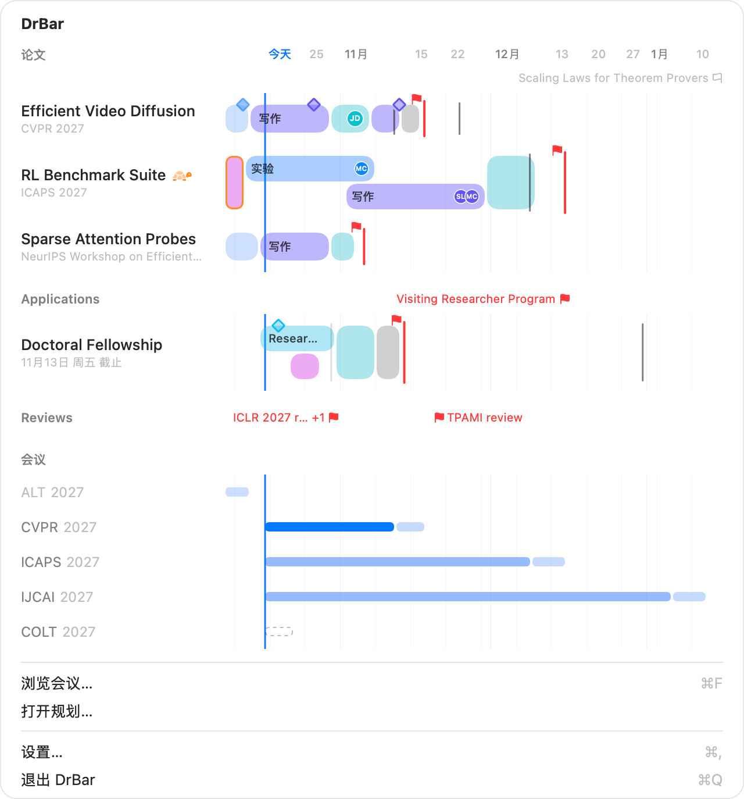

# DrBar 使用指南

从第一次打开，到一份自己就会出现在眼前的计划：DrBar 显示什么、怎么读、怎么改。[English](GUIDE.md)

1. [安装和打开](#1-安装和打开)
2. [看懂菜单栏](#2-看懂菜单栏)
3. [菜单栏下的窗口](#3-菜单栏下的窗口)
4. [关注会议](#4-关注会议)
5. [添加论文并排计划](#5-添加论文并排计划)
6. [在时间轴上编辑](#6-在时间轴上编辑)
7. [里程碑、DDL 和待办](#7-里程碑ddl-和待办)
8. [其他工作的分组](#8-其他工作的分组)
9. [往回看，往后看](#9-往回看往后看)
10. [提醒](#10-提醒)
11. [给导师发进度](#11-给导师发进度)
12. [Siri、聚焦搜索和快捷指令](#12-siri聚焦搜索和快捷指令)
13. [设置](#13-设置)
14. [键盘快捷键](#14-键盘快捷键)
15. [你的数据](#15-你的数据)
16. [遇到问题](#16-遇到问题)

## 1. 安装和打开

1. 从 [Releases](https://github.com/zhiheng-yang/DrBar/releases) 下载 `DrBar-<版本>.zip` 并解压。
2. 把 **DrBar** 拖进 **应用程序** 并打开。第一次打开时，macOS 无法验证 DrBar，不会打开它；凡是没有通过苹果付费开发者计划签名的 App 都会这样。打开 **系统设置 › 隐私与安全性**，在关于 DrBar 的提示旁点 **仍要打开** 并确认；在 macOS 14 上，也可以按住 Control 点 DrBar，选 **打开**。每个新版本第一次打开时都要这样允许一次。
3. DrBar 住在菜单栏里：那里会出现一个圆角边框，里面是学位帽；打开规划器之前，程序坞里没有它的图标。
4. 点一下这个边框。还没关注任何东西时，窗口会请你先给要投的会议标星，**浏览会议…**（⌘F）直接带你过去。

DrBar 需要 macOS 14 或更高版本。想开机自动启动，在设置里打开 **开机启动**。

## 2. 看懂菜单栏

<picture>
  <source srcset="images/framed/menubar-dark.png" media="(prefers-color-scheme: dark)">
  
</picture>

菜单栏里是一个圆角边框，它粗粗的边框就是一块表：时间沿着边框顺时针走，走到顶边正中间的 DDL。

- **有颜色的那一段就是剩下的时间。** 它从"现在"一直连到顶上，一圈就是这项工作从开始到 DDL 的时间（从计划的第一天算起，没有计划就从添加它的那天算起）：刚开始时整圈都有颜色，走到一半时剩半圈。DDL 越近，这一段越往顶上缩，像计时器一样。只关注、没有对应论文的会议，一圈是 30 天。
- **颜色表示远近：** 时间还多时是你的强调色（强调色是红或橙时用蓝色），一周内变橙，三天内变红，这时学位帽也会换成红色的 **!**。
- **名字** 是最近要交的会议或工作，旁边还可以显示剩余天数。

给菜单栏指定一篇论文或一个事项后，绕着边框走的就换成它的计划，从第一天一直到顶上的 DDL：

- 每个时间块是一段，用这个块自己的颜色，**做完的是实心**，还没做的是浅色；
- 一个 **小圆点** 标出今天：计划正常时是普通颜色，有工作逾期时变 **橙**，有工作排到 DDL 之后时变 **红**；
- 边框上一道 **红色刻度** 就是 DDL，排到 DDL 之后的块会越过这道刻度。
- 几个块 **时间重叠** 时，边框上同一时刻只显示一个：从后开始的那个块开始的那天起显示它；先开始的块如果结束得更晚，后面还会接着显示。窗口里的时间轴会把它们上下叠开，都看得到。

所以做完了多少（圆点之前的实心）、现在在哪（圆点）、还剩多少（圆点之后的浅色），一眼就能看出来，哪一类工作落后了也看得到。

要选菜单栏显示什么：在任何论文、事项或会议的右键菜单里点 **在菜单栏显示**，或者在设置里改 **菜单栏显示**。样式也在设置里：

| 样式 | 显示 |
|---|---|
| 图标和名称 | 最近 DDL 的名字；指定的工作还会带上天数 |
| 图标、名称和天数 | 名字和剩余天数，例如 `12d`，不到一天时是 `5h12m` |
| 两个 DDL | 接下来两个 DDL，各自一个边框写着天数 |
| 只显示图标 | 边框里只有图标，菜单栏很挤时用 |

## 3. 菜单栏下的窗口

<picture>
  <source srcset="images/framed/popover-dark-zh.png" media="(prefers-color-scheme: dark)">
  
</picture>

点菜单栏里的边框，会打开一张小甘特图。所有横条共用同一条时间轴，所以离得多远，就是横条有多长。

- 最上面是 **论文**，然后是你的各个分组，最后是你关注的 **会议**。
- 一篇论文的那一行就是它的计划：每个时间块一段，做完的是实心，没做的是浅色。横条上沿的菱形是里程碑。穿过横条的 **红线** 是计划瞄准的 DDL，旁边立着一面小红旗；灰色细线是它的其他 DDL。
- 只有 DDL 的工作（比如某天要交的一份审稿）没有自己的一行：它的 **小旗** 插在所属分组名字的那一行上，旗边写着事项名。
- 工作下面关注的会议是又细又安静的横条，从今天连到 DDL：先是摘要，颜色浅一点的后半段是论文 DDL。
- 把 **指针停** 在时间块、名字或会议上，可以看到横条说不清的：谁参与、准确时间、剩余时间、接下来的待办。
  **点会议** 可以看详情。
- **点一个时间块** 就选中它：按 Delete 或 Backspace 删除它（它会先进"最近删除"，⌘Z 也能撤销），← → 挪一天（按住 ⇧ 是一周），回车在规划器里打开它。

## 4. 关注会议

打开规划器（窗口里的 **打开规划…**，或按 ⌘F 直接到 **会议** 页）。

<picture>
  <source srcset="images/framed/conferences-dark-zh.png" media="(prefers-color-scheme: dark)">
  
</picture>

- 列表像 [ccfddl](https://github.com/ccfddl/ccf-deadlines) 网站一样列出所有即将到来的会议：全称、举办时间地点、
  CCF / CORE / TH-CPL 等级、领域、录用率，以及摘要和论文 DDL 和剩余时间。
- 可以 **搜索**，用列表上方的按钮只看你选的领域和等级，按 DDL、名称、等级或录用率排序，也可以显示往届会议。
- 给你要投的会议 **标星**。星标跟着会议系列走，明年的新一届会自动关注。标星的会议会出现在菜单栏窗口里，也会在菜单栏里倒计时。

数据最多每 12 小时自动更新一次；离线时一切照常。

## 5. 添加论文并排计划

1. 在规划器里 **新建论文**（⌘N），或点侧栏"论文"旁边的 **+**，输入标题。
2. 在标题下面点目标菜单，选 **选择会议…**。选好届次，有多轮的再选轮次。这篇论文就有了这一轮的全部
   DDL：摘要注册、论文提交、rebuttal 和录用通知。
3. 点 **从 DDL 倒推生成**。DrBar 从论文 DDL 往前倒推：缓冲 2 天、内审修改 7 天、写作 14 天，从今天到开始写作之前是实验。之后可以随手调整，之后再也不会自己动。
4. 在目标旁边的菜单里设置 **阶段**（构思、实验、写作、已投稿、已出结果）。设为已投稿，会把论文 DDL
   和它之前的 DDL 都勾掉。

<picture>
  <source srcset="images/framed/paper-dark-zh.png" media="(prefers-color-scheme: dark)">
  
</picture>

有工作逾期时，论文会显示 **落后**；工作排到它要赶的 DDL 之后时，会显示 **冲突**。

## 6. 在时间轴上编辑

在论文页上，计划里每类工作占一行，编辑方式和"日历"一样：

| 想要 | 这样做 |
|---|---|
| 画一个时间块 | 在某一行的空白日子上拖过去；双击画出一周 |
| 再加一轮 | 指针移到这一行的名字上，点 **+** |
| 加长或缩短 | 拖它的任意一端 |
| 挪动 | 拖它的中间，按天对齐；碰到今天、DDL 或别的块时触控板会轻轻震一下 |
| 复制 | 按住 ⌥ 拖动，或选中后按 ⌘D |
| 选中 | 点一下；键盘能操作它时，选中环是蓝色的 |
| 删除 | 选中后按 Delete 或 Backspace，或用它的右键菜单 |
| 微调 | ← →，一天；按住 ⇧，一周 |
| 改名字、日期或参与的人 | 双击，或按回车 |
| 标为完成 | 时间块列表里点它的圆圈，或右键菜单里的 **标为已完成** |
| 撤销 | ⌘Z，一步一步撤 |

在总览和菜单栏窗口里也能拖动。拖到横条区域的两端附近，时间轴会跟着滚动。拖动时按 Esc，块会回到原处。

可以在时间块的编辑框或右键菜单里加上参与的人（比如内审的导师、做实验的合作者），他们会以小小的姓名缩写显示在块上。

## 7. 里程碑、DDL 和待办

- **里程碑** 是某件事要在哪天之前完成，比如内部 DDL、给导师交初稿：在"里程碑"那一行双击空白的一天，或点 **+**。它是一个菱形，做完后变实心，过了日子还没做时描上橙边。
- **自己的 DDL**（补充材料、camera-ready、workshop、申请的推荐信）放在"DDL"那一行：双击某一天，或在目标菜单里点 **添加 DDL…**。每个都有名字、时区（本地、AoE、UTC、UTC±N 或 PT）、链接和备注。
- **红旗** 标出计划瞄准的 DDL，它完成后换成下一个。DDL 过了就在 DDL 列表里勾掉。
- **待办** 是每篇论文的一个小清单：在最后一行输入就能新增，做完打勾，**清除已完成** 会把勾掉的删掉。

## 8. 其他工作的分组

除了"论文"，还可以给其他有 DDL 的工作建分组：申请、审稿、助教。

- 在侧栏底部点 **新建分组**（⇧⌘N），输入名字，再从它的右键菜单里选一个图标。
- 点分组旁边的 **+** 添加事项。事项和论文一样可以排时间块、里程碑、DDL 和提醒，只是没有阶段和进度邮件。
- 没有时间块的事项就只有 DDL：在菜单栏窗口和总览里是插在分组那一行上的小旗，同一天截止的合成一面。加上第一个时间块后，它才有自己的一行。
- 拖动分组标题可以调整分组顺序，把事项拖进别的分组就移到那个分组里。

## 9. 往回看，往后看

- 在触控板上 **左右滑**、横向滚动，或在空白处拖动，都能移动时间轴，前后最多一年。⌘← 和 ⌘→ 一步一步走，
  ⌘T 回到今天；点 **‹ 今天** 或双击日期也一样。
- **双指捏合**，或按住 ⌘ 上下滚动，可以在三天到两年之间缩放。⌘+ 和 ⌘− 以今天为中心缩放，⌘0 回到选定的范围：1 周、1 个月、3 个月或 6 个月。
- 放大后每天各占一格、周末有底色，剩下几天在横条上就能数出来。在任何时间轴上方的日期上点右键，可以选择标
  **日期**、**距今天数**，或者两个都标。
- **显示 › 行高** 可以把所有行设成大、中、小，最小时每个名字旁只剩一条细横条。

## 10. 提醒

在 **设置 › 提醒** 里打开提醒；macOS 这时才会请求通知权限，之前不会打扰你。

- 每个 DDL 前 7、3、1 天提醒（还可以加 14 天和 30 天），同一个 DDL 不管几篇论文都只提醒一次；
- 时间块最后一天的 9:00、里程碑当天，在通知里就能直接 **标为已完成**；
- ccfddl 改动了你关注的日期时。

## 11. 给导师发进度

1. 在 **设置 › 邮件** 里填上你的名字和发件地址，把人放进分组：导师、合作者，或者你自己建的分组，每个分组可以选邮件语言。
2. 在论文页上点 **发送进展**。窗口里能看到要发的图片、主题和第一行；想写几句就写，然后点 **发送**（⌘↩）。

邮件由"邮件"App 用你自己的账户发出，作为上一封进度的回复放在同一个对话里，所以每个分组只看到一个对话。第一行不点开就能看到最要紧的事。勾选 **附上其他工作** 会写上你同时在做的事，只包括你在 **谁可以看** 里勾选了全部收件人的工作。

## 12. Siri、聚焦搜索和快捷指令

按 Siri 设置的语言说或打字给 Siri：

| 说 | 做什么 |
|---|---|
| "DrBar里接下来是什么" | 说出最近的 DDL、具体时间和还剩多久 |
| "在DrBar里新建事项" | 依次问名字、哪天截止、放在哪个分组，然后添加 |
| "在DrBar里添加到审稿" | 同上，直接加进"审稿"分组 |
| "在DrBar里给JCC加DDL" | 给它加一个自己的 DDL |
| "在DrBar里给Video Diffusion加时间块" | 问工作类型、哪天开始、几天 |
| "在DrBar里推迟Video Diffusion的时间块" | 问是哪一块、新的开始日期 |
| "在DrBar里延长Video Diffusion的时间块" | 问是哪一块、新的结束日期 |
| "在DrBar里把Video Diffusion的时间块标为完成" | 把它标为完成 |
| "在DrBar里打开JCC" | 在规划器里打开它 |

Siri 是英文时，说 "What's next in DrBar?"、"Add a new item in DrBar"、"Postpone a block of Video
Diffusion in DrBar"。

同样的操作也在 **聚焦搜索**（⌘空格，输入"下一个 DDL"）和 **快捷指令** App 的 DrBar 下面，可以放进你自己的快捷指令里。新的标题保存后 Siri 就能听懂。用这种方式什么也删不掉。

## 13. 设置

- **通用：** 外观、默认范围、时间轴标注、行高、菜单栏样式和显示内容、开机启动。
- **提醒：** 开关、提前多久、时间块提醒、日期变动提醒。
- **邮件：** 你的名字和地址、收件人分组和其中的人。
- **数据：** 同步状态和立即同步、数据文件夹、导出和导入、**移除所有数据…**。

## 14. 键盘快捷键

| 按键 | 作用 |
|---|---|
| ⌘N、⇧⌘N | 新建论文、新建分组 |
| ⌘F | 浏览会议 |
| ⌘← ⌘→、⌘T | 往前、往后、回到今天 |
| ⌘+ ⌘−、⌘0 | 放大、缩小、回到选定范围 |
| ⌘[ ⌘] | 在页面之间后退、前进 |
| Delete、Backspace | 删除选中的时间块、里程碑或 DDL |
| ← →、⇧← ⇧→ | 把选中的挪一天、一周 |
| 回车、Esc | 编辑选中的、取消选中 |
| ⌘D | 在选中的时间块后面复制一份 |
| ⌘Z、⇧⌘Z | 撤销、重做 |
| ⌘, | 设置 |

## 15. 你的数据

所有东西都留在你的 Mac 上，在 DrBar 自己的沙盒文件夹里：没有账户，没有统计。唯一的下载是 ccfddl 的会议数据。不管删掉的是整篇论文还是一个时间块，都会在 **最近删除** 里保留 30 天。**归档** 会把做完的工作连同它的一切收起来。

卸载时，先在 设置 › 数据 里点 **移除所有数据…**，再把 DrBar 拖进废纸篓。

## 16. 遇到问题

- **日期看起来不对：** DrBar 完全按 ccfddl 的数据显示日期。请以会议官网为准，
  [向 ccfddl 报告](https://github.com/ccfddl/ccf-deadlines/issues)，修好之前先给论文加一个自己的 DDL。
- **Siri 说不认识 DrBar：** App 放在"应用程序"里、并从那里打开过之后，Siri 才会学到它的操作。把 DrBar
  放进"应用程序"、打开它、等一分钟，先去"快捷指令"App 里看看：那里应该能看到 DrBar 的操作。要用 Siri
  当前设置的语言说。自己编译的话，`scripts/run.sh` 会把它放进 `~/Applications`；只做了本地签名的版本仍可能被 Siri 拒绝，用你 Apple ID 的免费团队在 Xcode 里签名（在 `Config/Local.xcconfig` 里填 `DEVELOPMENT_TEAM`），
  Siri 就有了可以信任的开发者。
- **按 Delete 没反应：** 先点一下那个时间块；键盘能操作它时，选中环会变成蓝色。
- **收不到提醒：** 到 系统设置 › 通知 里确认 DrBar 的通知是打开的。
